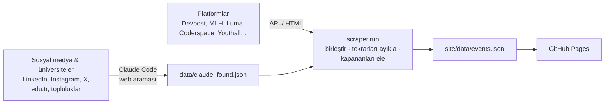

<div align="center">

# 📡 Hackathon Radar

**Başvurusu açık hackathon, ideathon, datathon ve yarışmalar, tek sayfada.**
Türkiye odaklı, her gün kendiliğinden güncellenir.

### 👉 [ayse-solmaz.github.io/hackathon-radar](https://ayse-solmaz.github.io/hackathon-radar/)

[](https://github.com/ayse-solmaz/hackathon-radar/actions/workflows/update.yml)

</div>

---

## Ne işe yarar?

Hackathon duyuruları onlarca yere dağılmış durumda: Devpost, Luma, Coderspace, Youthall, üniversite siteleri, LinkedIn ve Instagram gönderileri... Hackathon Radar bunların hepsini her sabah tarar. Sonra **başvurusu kapanmış olanları eler** ve geriye kalanları tek bir listede toplar.

- 🇹🇷 **Türkiye önce**: Türkiye'deki etkinlikler ayrı bir bölümde, en üstte durur. Online ve yurt dışı etkinlikler altta listelenir.
- ⏰ **Son başvuruya göre sıralı**: süresi en yakın dolacak olan en üstte, "3 gün kaldı" gibi uyarılarla.
- 🆕 **Yeni eklenenler** işaretli, istersen sadece onları görebilirsin.
- 🔎 Tür (hackathon / ideathon / datathon / yarışma), konum, kaynak ve serbest metin araması.
- Sunucu yok, veritabanı yok: sadece statik bir site ve tek bir JSON dosyası.

## Nasıl çalışır?



1. **Platform kaynakları** (`scraper/sources.py`) API'lerden ve sayfalardan yapılandırılmış veri çeker.
2. **Sosyal medya taraması** (`scraper/claude_prompt.md`): Instagram, LinkedIn, X ve TikTok doğrudan kazımayı engelliyor. Bu yüzden bu kaynakları Claude Code web aramasıyla tarıyor. Bulduğu açık yarışmaları `data/claude_found.json` dosyasına yazıyor.
3. **`scraper/run.py`** hepsini birleştirir. Önce tarihi geçmiş etkinlikleri eler, sonra aynı etkinliğin farklı kaynaklardan gelen kopyalarını ayıklar (URL'e ve normalize edilmiş başlığa bakarak). Sonucu `site/data/events.json` olarak yazar.
4. GitHub Actions sonucu commit'ler ve siteyi Pages'e yayınlar.

**Bir etkinlik ne zaman listeden düşer?** Son başvuru tarihi geçince. Son başvuru tarihi yoksa etkinlik başladığında düşer. Hiç tarih yoksa (çoğu sosyal medya gönderisinde olduğu gibi) ilk görüldükten 21 gün sonra düşer.

## Kaynaklar

| Kaynak | Yöntem | Anahtar gerekir mi? |
|---|---|---|
| Devpost | Public JSON API | Hayır |
| MLH | Sayfaya gömülü JSON | Hayır |
| Luma | Discover API: anahtar kelime aramaları ve 9 Türk şehri çevresi | Hayır |
| Coderspace | JSON-LD, son başvuru detay sayfasından | Hayır |
| Techcareer.net | Next.js sayfa verisi | Hayır |
| Youthall, Anbean Kampüs | HTML kartları, son başvuru detay sayfasından doğrulanır | Hayır |
| TEKNOFEST | Yarışma kartları (sadece başvurusu açık olanlar) | Hayır |
| Kaggle | Kaggle API | `KAGGLE_USERNAME`, `KAGGLE_KEY` |
| LinkedIn, Instagram, X, TikTok, üniversiteler (edu.tr), Kommunity, GDG, Patika, BTK Akademi… | Claude Code web araması | `CLAUDE_CODE_OAUTH_TOKEN` (Claude Pro/Max aboneliği, API ücreti yok) |
| Aynı kaynaklar (alternatif) | Google araması (Serper.dev) ve isteğe bağlı Claude API ayıklaması | `SERPER_API_KEY`, `ANTHROPIC_API_KEY` |

> Bir kaynaktan 0 kayıt gelmesi her zaman hata anlamına gelmez. Örneğin TEKNOFEST'in başvuru dönemi dışında açık yarışması olmaz. Bir kaynak gerçekten hata verirse loglarda `[Kaynak] HATA:` satırı görünür, diğer kaynaklar çalışmaya devam eder.

## Kendi kopyanı kurmak

1. Repoyu fork'la.
2. Claude abonelik token'ını oluştur ve secret olarak ekle (isteğe bağlı ama önerilir, sosyal medya taraması bununla yapılıyor):
   ```bash
   claude setup-token
   gh secret set CLAUDE_CODE_OAUTH_TOKEN
   ```
   Diğer isteğe bağlı secret'lar: `KAGGLE_USERNAME`, `KAGGLE_KEY`, `SERPER_API_KEY`, `ANTHROPIC_API_KEY`.
3. **Settings → Pages → Source: GitHub Actions** ayarını yap.
4. **Actions → Günlük güncelleme ve yayın → Run workflow** ile ilk çalıştırmayı başlat.

Workflow her gün 07:00'de (TR saati) kendiliğinden çalışır.

## Yerelde çalıştırma

```bash
python -m venv .venv
.venv/Scripts/pip install -r requirements.txt     # macOS/Linux: .venv/bin/pip

.venv/Scripts/python -m scraper.run               # veriyi topla -> site/data/events.json
python -m http.server 8765 --directory site       # http://localhost:8765
```

`site/index.html` dosyasını tarayıcıda doğrudan da açabilirsin, `events.js` sayesinde sunucusuz da çalışır.

**Kendi bilgisayarında günlük tarama:** `run_daily.cmd` dosyasını Windows Görev Zamanlayıcı'ya ekle. Her çalıştığında üç şey yapar:

1. Bilgisayarındaki `claude` oturumuyla sosyal medya taramasını çalıştırır (token gerekmez).
2. Scraper'ı çalıştırır.
3. Sonucu GitHub'a gönderir.

Loglar `logs/` klasörüne yazılır.

**Testler:**

```bash
python -m unittest discover -s tests -t .
```

## Proje yapısı

```
scraper/
  common.py          Event modeli, HTTP oturumu, tür tespiti, Türkçe/İngilizce tarih ayrıştırma
  sources.py         Platform kaynakları (her biri list[Event] döndüren bir fonksiyon)
  social.py          Claude Code çıktısını okuma + Serper alternatifi
  claude_prompt.md   Sosyal medya taraması için Claude talimatı (Actions ve yerel çalıştırma ortak)
  run.py             Hepsini birleştirir, ayıklar, events.json yazar
  daily.py           Yerel günlük çalıştırma: Claude taraması → scraper → git push
site/                Statik site (index.html, app.js, style.css) ve data/events.json
data/                Claude tarama sonucu ve LLM önbelleği
tests/               Tarih ayrıştırma, tür tespiti, aktiflik kuralları
```

## Yeni kaynak eklemek

`scraper/sources.py` içine `list[Event]` döndüren bir fonksiyon yaz ve `ALL` sözlüğüne ekle:

```python
def ornek_site() -> list[Event]:
    data = get("https://ornek.com/api/events").json()
    return [
        Event(title=e["name"], url=e["link"], source="Örnek",
              type=detect_type(e["name"]) or "hackathon",
              deadline=e.get("deadline"), turkey=True)
        for e in data
    ]

ALL = { ..., "Örnek": ornek_site }
```

Bir kaynağın hata vermesi diğerlerini durdurmaz. Sosyal medya arama sorguları `scraper/claude_prompt.md` dosyasında (Serper için `scraper/social.py` → `QUERIES`).

---

Eksik bir etkinlik ya da yanlış bir tarih görürsen [issue aç](https://github.com/ayse-solmaz/hackathon-radar/issues).
